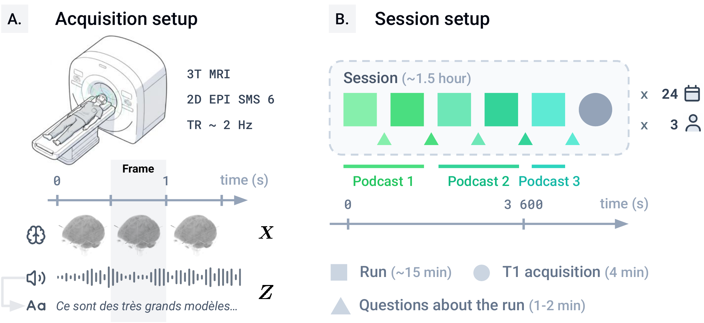
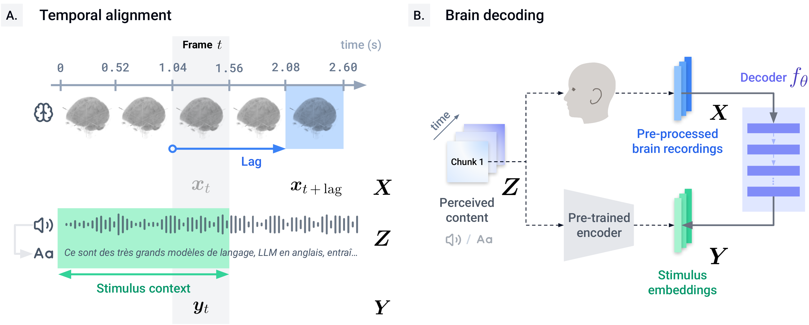
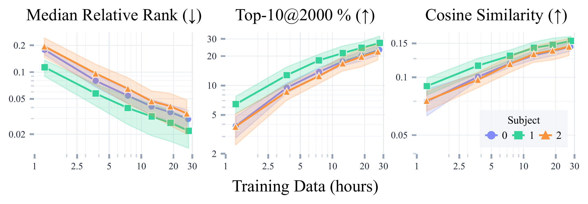

# Cephalonauts One

[Dataset on Hugging Face](https://huggingface.co/datasets/karavela/cephalonauts_one) · [Demo](https://karavela.ai/en/research/cephalonauts-one) · [Paper](https://arxiv.org/abs/2610.03558) · [Discord](https://discord.gg/3jJZ6Ssb6U)

Cephalonauts One is a deep fMRI dataset for decoding naturalistic spoken language from the human brain.
It contains 89.31 hours of whole-brain 3T fMRI from three French-speaking participants listening to podcasts across 72 sessions and 358 runs.
The dataset pairs fMRI responses with text and audio embeddings and provides ready-to-use training, validation, and test splits.

This repository provides the baseline decoder, scaling experiments, and sample preparation code.
See the [dataset card](https://huggingface.co/datasets/karavela/cephalonauts_one) for recording statistics, data formats, packaged splits, access conditions, and loading examples.



*Overview of the acquisition protocol.
Participants listened to naturalistic podcast episodes during fMRI sessions composed of five runs, with comprehension questions after each run.*

## Citation and acknowledgement

When publicly presenting work that uses Cephalonauts One, please acknowledge the dataset as described in the access terms:

> The data used were [in part] provided by the Cephalonauts One project, managed and funded by Karavela.

Please also cite our [paper](https://arxiv.org/abs/2610.03558) from the NeurIPS 2026 Evaluations & Datasets Track:

```bibtex
@inproceedings{collas2026cephalonauts,
  title = {{Cephalonauts One}: A deep {fMRI} dataset for decoding naturalistic speech in the human brain},
  author = {Collas, Antoine and Jalouzot, Louis and Ilinca, Géraud and Caris, Corentin and Valabrègue, Romain and Hassayoune, Ahmed and Goncalves, David and Hueber, Madeleine and Delebarre, Thaddée and Savatovsky, Julien and Fonteneau, Clara and Maussion, Charles and Thirion, Bertrand and Thual, Alexis},
  booktitle = {Advances in Neural Information Processing Systems},
  year = {2026},
  note = {Evaluations and Datasets Track},
  url = {https://arxiv.org/abs/2610.03558}
}
```

## Installation

Clone this repository and install its dependencies with [uv](https://docs.astral.sh/uv/getting-started/installation/):

```bash
# Clone the code and activate its environment.
git clone https://github.com/karavela-ai/cephalonauts_one.git
cd cephalonauts_one
uv sync
source .venv/bin/activate
```

This installs the dependencies for all scripts in `scripts/`. Run the commands below from the repository root.
The dataset is gated: request access on [Hugging Face](https://huggingface.co/datasets/karavela/cephalonauts_one), then authenticate locally:

```bash
# Authenticate with the account that has dataset access.
hf auth login
```

## Decoding setup



*Decoding setup.
A pretrained text or audio encoder defines the target embedding space, and a decoder is trained to predict those stimulus embeddings from aligned fMRI responses.*

The baseline defaults to text targets.
The baseline is a one-hidden-layer MLP with 4096 hidden units, GELU, and dropout 0.5.
It uses AdamW with learning rate and weight decay `3e-4`, batch size 2048, and CLIP temperature 0.02.
Training runs for at most 100 epochs with patience 5 on validation median relative rank.
Training uses a symmetric CLIP-style contrastive loss.
The best checkpoint is selected on validation median relative rank, then evaluated once on the held-out test session.

## Run the baseline

`scripts/baseline.py` trains and evaluates one decoder. These options control the prediction target and the data used:

- `--target` chooses what the decoder predicts: `text` for text embeddings (default), `audio` for audio embeddings, or `both` for concatenated text and audio embeddings.
- `--space` chooses the fMRI representation: `fsaverage5` for cortical surface data (default), `T1w` for native anatomical-space volumes, or `MNI` for template-space volumes.
- `--sub` chooses the subject: `0` (default), `1`, or `2`.
- `--fold` chooses the training, validation, and test sessions. Without it, the [packaged dataset splits](https://huggingface.co/datasets/karavela/cephalonauts_one#data-construction) are used. With folds 0–4, the test sessions are 19, 20, 21, 22, and 23, respectively; the validation sessions are 20, 21, 22, 23, and 19. All remaining sessions are available for training.
- `--n-train-sessions` chooses how many training sessions to use. Without it, all available training sessions are used.

Run these examples from the repository root:

```bash
# Train and evaluate using the packaged splits.
python scripts/baseline.py --target text
python scripts/baseline.py --target audio
python scripts/baseline.py --target both

# Use six training sessions from the packaged training split.
python scripts/baseline.py --target text --n-train-sessions 6

# Use fold 0 and all its training sessions.
python scripts/baseline.py --target text --fold 0

# Use fold 0, but train on six sessions.
python scripts/baseline.py --target text --fold 0 --n-train-sessions 6
```

These examples use subject 0 and `fsaverage5`; change them with `--sub` and `--space`.

When selecting fewer than all training sessions, only sessions with exactly five runs are eligible.
Repeating the same command selects the same training sessions.
When only `--n-train-sessions` changes, a smaller selection is contained in a larger one.
Using all training sessions also includes sessions with a different number of runs.

## Evaluation protocol

The `train` and `val` splits can be used for model development and hyperparameter tuning, and the `test` split is used to report final metrics.

Evaluation should always be performed on held-out sessions for proper generalization testing.
This protocol is stricter than random-sample splitting because neighboring samples from the same podcast are highly correlated.
Keeping sessions separate tests whether a decoder generalizes across acquisition days and across naturalistic stimuli.

For a held-out split with $N$ examples, let $\hat{y}_i$ be the predicted embedding for fMRI sample $i$, and let $y_j$ be candidate stimulus embedding $j$.

We compute cosine similarities:

```math
s_{ij} = \frac{\hat{y}_i^\top y_j}{\|\hat{y}_i\|_2 \|y_j\|_2}
```

We define the retrieval rank as the position of the correct target when all candidates are ranked by their cosine similarity to the predicted embedding:

```math
r_i = \sum_{j=1}^{N} \mathbb{1}\left[s_{ij} > s_{ii}\right] + 1
```

The reported metrics are:

**Average Cosine Similarity (↑):**

```math
\frac{1}{N}\sum_i s_{ii}
```

**Median Relative Rank (↓):**

```math
\mathrm{median}_i \frac{r_i}{N}
```

**Top-10 Retrieval Accuracy (%, ↑):**

```math
\frac{100}{N}\sum_i \mathbb{1}\left[r_i \leq10\right]
```

Retrieval metrics are computed against the full held-out split, not only against the current minibatch.

The baseline also reports the training data duration in hours.

## Scaling laws

`scripts/scaling_laws.py` runs the baseline across evaluation folds and training set sizes.
It repeats baseline training for all combinations of 3 subjects, 5 folds, and 6 training sizes (1, 3, 6, 10, 15, and 22 sessions), for a total of 90 runs, then writes `scaling_laws.csv` and `scaling_laws.pdf`.

Completed runs are cached under `.cache` with `joblib.Memory`.
The default sweep uses `fsaverage5` and concatenated text/audio targets; use `--space T1w` or `--space MNI` for another space.
This is a full experiment sweep and can take a long time to run; run a single baseline command first for a quick environment check.

```bash
# Run the full scaling experiment.
python scripts/scaling_laws.py
```



*Baseline performance as a function of training-set size.
Text and audio decoding improve as more within-subject data are available, with no clear saturation over the range studied.*

## Regenerating decoder samples

The prepared `sub-*_fsaverage5`, `sub-*_T1w`, and `sub-*_MNI` configurations are ready to train on directly.
If you need to inspect or regenerate the decoder-ready tables from the lower-level `timeseries` metadata, use [`scripts/make_decoding_samples.py`](scripts/make_decoding_samples.py).

The script downloads per-run fMRI arrays, stimulus audio, and transcripts from this gated dataset, preprocesses the fMRI signal, builds aligned samples every 2080 ms, embeds transcript and audio contexts, and creates the resulting `X`, `Y_text`, and `Y_audio` columns.

This script is included for transparency and advanced users who may want to use different embedding models or preprocessing steps.
It is compute and memory intensive because it loads large embedding models and audio waveforms.
By default, it saves generated splits locally under `.cache/cephalonauts_one/sub-<sub>_<space>`.

```bash
# Rebuild one subject and space, then save the generated splits locally.
python scripts/make_decoding_samples.py --sub 0 --space fsaverage5
```

## License

This repository is licensed under [CC BY 4.0](LICENSE).

## Data usage terms

Dataset access and reuse are governed by the [Hugging Face access terms and source rights](https://huggingface.co/datasets/karavela/cephalonauts_one#license-and-source-rights).
